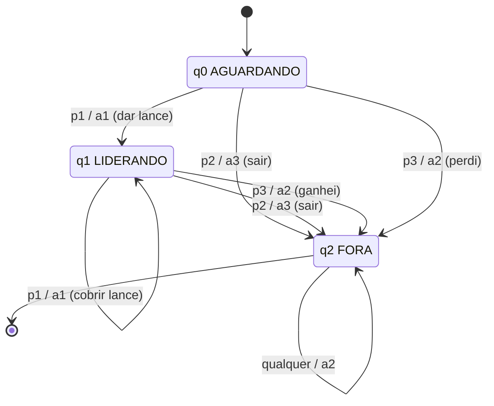

# Atividade sobre agentes inteligentes

Aula 20/10/2026 | Professora Kadidja Valéria | Inteligência artificial

**Disciplina:** Linguagens Formais e Autômatos | Ciência da Computação

**Estudante:** Luis Fernando Vieira  Borges  | **Turma:** N1 C.C

Realize os exercícios 2.3, 2.4 e 2.5 do Capítulo 2 sobre agentes inteligentes. Analise a racionalidade, descreva ambientes de tarefa por meio do modelo PEAS e explique os conceitos com suas próprias palavras. Utilize o capítulo disponibilizado e justifique suas respostas.

---

## Preparação

Antes de responder, reli as Seções 2.2 (racionalidade), 2.3 (natureza dos ambientes, com foco na 2.3.2) e 2.4 (estrutura dos agentes). Três ideias guiaram quase todas as respostas abaixo:

1. **Racional não é o mesmo que perfeito.** O agente racional maximiza o desempenho *esperado* com base no que percebeu até agora, e não o resultado real, que ele não tem como adivinhar.
2. **Função e programa são coisas diferentes.** A função de agente é a descrição matemática (sequência de percepções → ação). O programa é o código que roda numa máquina e recebe só a percepção atual.
3. **A classificação de um ambiente depende das hipóteses.** O próprio livro diz que as respostas "nem sempre são definitivas". Por isso, em cada caso deixei claro o que estou assumindo.

---

## Exercício 2.3

### a. Um agente que detecta apenas informações parciais sobre o estado não pode ser perfeitamente racional.

- **Julgamento:** F
- **Justificativa:** A definição de racionalidade do capítulo já leva em conta o que o agente consegue perceber: a ação deve maximizar o desempenho esperado *dada a sequência de percepções* e o conhecimento que ele tem. Ninguém exige que o agente saiba o que não pode ver, porque isso seria onisciência. Ver só parte do estado limita o desempenho máximo possível, mas não impede o agente de fazer a melhor escolha com o que tem.
- **Exemplo ou contraexemplo:** O próprio aspirador de pó da Seção 2.2.1. Ele só percebe o quadrado em que está e se ali há sujeira; não sabe nada sobre o outro quadrado. Mesmo assim, com a medida de desempenho de "um ponto por quadrado limpo a cada passo", o livro mostra que ele é racional.
- **Hipótese:** a medida de desempenho e o ambiente são os do exemplo do livro (dois quadrados, geografia conhecida, sujeira que não volta).

### b. Existem ambientes de tarefa nos quais nenhum agente reativo puro pode comportar-se racionalmente.

- **Julgamento:** V
- **Justificativa:** O agente reativo puro decide só pela percepção atual. Ele não tem memória, então a mesma percepção sempre gera a mesma ação. Se o ambiente exigir respostas diferentes para a mesma percepção, dependendo do que aconteceu antes, nenhum reativo dá conta.
- **Exemplo ou contraexemplo:** Imagine uma tarefa em que o agente deve apertar um botão exatamente três vezes e depois parar, e a percepção dele é sempre a mesma ("botão disponível"). Um reativo puro ou aperta sempre ou nunca aperta. Ele não tem como contar até três. Outro exemplo, do próprio livro: o aspirador que só tem sensor de sujeira, sem sensor de posição. Ao perceber [Limpo], se a regra for "ir para a esquerda", ele fica preso para sempre se começou no quadrado A.
- **Hipótese:** "reativo puro" significa determinístico e sem nenhum estado interno.

### c. Existe um ambiente de tarefa em que todo agente é racional.

- **Julgamento:** V
- **Justificativa:** Racionalidade é sempre medida em relação a uma medida de desempenho. Se essa medida der a mesma nota para qualquer comportamento, todas as ações são igualmente boas, e qualquer agente está "maximizando" o desempenho.
- **Exemplo ou contraexemplo:** Um ambiente em que só existe uma ação possível (por exemplo, "não fazer nada"). Todo agente necessariamente escolhe essa ação e, portanto, escolhe a melhor. Outro caso: um ambiente cuja medida de desempenho vale sempre zero, independente do que aconteça.
- **Hipótese:** o exemplo é artificial de propósito. A pergunta é sobre *existir* um ambiente assim, e basta um caso para a afirmação ser verdadeira.

### d. A entrada para o programa de agente é a mesma que a entrada para a função de agente.

- **Julgamento:** F
- **Justificativa:** O livro deixa essa diferença bem explícita na Seção 2.4.1. A **função** de agente recebe toda a sequência de percepções (o histórico completo). O **programa** recebe só a percepção atual, porque é isso que chega dos sensores naquele instante. Se o programa precisar do histórico, ele mesmo tem que guardar o que já viu.
- **Exemplo ou contraexemplo:** No AGENTE-DIRIGIDO-POR-TABELA (Figura 2.7), o programa recebe uma percepção por vez e vai anexando cada uma numa variável interna `percepções`. Só depois consulta a tabela, que é indexada pela sequência inteira. A tabela representa a função; o programa recebe uma percepção só.

### e. Toda função de agente é implementável por uma combinação de programa/máquina.

- **Julgamento:** F
- **Justificativa:** A função de agente é um objeto matemático e pode descrever coisas que nenhum computador consegue calcular. Algumas funções são simplesmente não computáveis. Outras até são computáveis em teoria, mas exigiriam memória ou tempo que nenhuma máquina real tem.
- **Exemplo ou contraexemplo:** Um agente que recebe como percepção o código de um programa qualquer e deve responder "para" ou "não para", conforme esse programa termine ou não. Isso é o problema da parada, e sabemos (inclusive da própria disciplina de LFA) que nenhuma máquina de Turing o resolve para todas as entradas. Um exemplo mais prático: a tabela da Figura 2.7 para um táxi automatizado teria um número de entradas maior que o número de átomos do universo, então não cabe em nenhuma máquina.

### f. Suponha que um agente selecione sua ação uniformemente ao acaso do conjunto de ações possíveis. Existe um ambiente de tarefa determinista em que esse agente é racional.

- **Julgamento:** V
- **Justificativa:** Se todas as ações disponíveis levam ao mesmo desempenho, escolher qualquer uma delas, inclusive sorteando, é tão bom quanto escolher com cuidado. O ambiente ser determinístico não atrapalha isso.
- **Exemplo ou contraexemplo:** Um ambiente determinístico com uma única ação possível: sortear entre uma opção só dá sempre a opção certa. Outro exemplo: um jogo em que o agente escolhe a cor de um botão (vermelho ou azul) e ganha um ponto de qualquer jeito. O resultado é totalmente previsível, e o agente aleatório faz sempre o melhor possível.
- **Observação:** em ambientes determinísticos "interessantes", em que as ações têm consequências diferentes, o agente aleatório normalmente *não* é racional. O livro comenta que, em ambientes de agente único, aleatoriedade em geral não é racional. Mas a questão pergunta se *existe* um ambiente assim, e existe.

### g. É possível para um dado agente ser perfeitamente racional em dois ambientes de tarefa distintos.

- **Julgamento:** V
- **Justificativa:** Nada obriga um agente a ser racional em um único ambiente. Se dois ambientes diferem em aspectos que não mudam qual é a melhor ação, o mesmo agente pode ser ótimo nos dois.
- **Exemplo ou contraexemplo:** O aspirador reativo simples é racional no mundo de dois quadrados com a sujeira inicial em A e também em outro ambiente idêntico em que a sujeira começa em B, ou em que o piso é de outra cor. São ambientes distintos, mas a regra "se sujo, aspira; se limpo, vai para o outro quadrado" continua sendo a melhor. Também dá para pensar em um agente que joga jogo da velha perfeitamente: ele é racional contra um oponente humano e contra um oponente aleatório.

### h. Todo agente é racional em um ambiente não observável.

- **Julgamento:** F
- **Justificativa:** Não ter sensores não significa que tanto faz o que o agente faz. Ele ainda tem conhecimento prévio sobre o ambiente e sobre o efeito das suas ações, e pode usar isso para agir bem. O livro comenta que, mesmo em ambientes inobserváveis, os objetivos ainda podem ser alcançáveis, às vezes com certeza (remetendo ao Capítulo 4).
- **Exemplo ou contraexemplo:** Um aspirador sem nenhum sensor no mundo de dois quadrados. Se ele executar a sequência [Aspirar, Direita, Aspirar, Esquerda, Aspirar], garante que os dois quadrados ficam limpos, não importa onde começou. Já um agente que fica parado para sempre também não vê nada, mas claramente não é racional, porque deixa a sujeira lá. Então nem todo agente é racional nesse ambiente.

### i. Um agente jogador de pôquer perfeitamente racional nunca perde.

- **Julgamento:** F
- **Justificativa:** O pôquer é parcialmente observável (não vejo as cartas dos outros), estocástico (as cartas são embaralhadas) e multiagente competitivo. Ser racional significa maximizar o resultado *esperado*, não garantir vitória. Esse é justamente o ponto da Seção 2.2.2: racionalidade não é onisciência.
- **Exemplo ou contraexemplo:** O agente tem uma mão muito forte, aposta tudo (a decisão correta pelas probabilidades) e o adversário, que fez uma jogada ruim, tira exatamente a carta que precisava no final. O agente perde aquela mão e não foi irracional por isso. Também pode perder simplesmente porque o adversário é tão bom quanto ele e recebeu cartas melhores ao longo da partida.

---

## Exercício 2.4

### Caso 1 — Jogar futebol.

- **Agente analisado:** um jogador (humano ou robô, como no RoboCup) de um dos times.
- **Objetivo e hipóteses:** ajudar o time a vencer a partida. Assumo uma partida oficial com 11 contra 11, regras da FIFA, juiz, e que o agente conhece as regras.
- **P — Medida de desempenho:** gols marcados, gols sofridos, vitória/empate/derrota, passes certos, desarmes, evitar faltas e cartões, poupar energia ao longo do jogo.
- **E — Ambiente:** campo, bola, traves, companheiros de time, adversários, árbitro e auxiliares, clima, torcida.
- **A — Atuadores:** pernas e pés (correr, chutar, driblar), cabeça (cabecear), corpo (proteger a bola), voz ou gestos (comunicar com o time).
- **S — Sensores:** olhos/câmeras, ouvidos/microfone (apito, chamado de colega), sentido de equilíbrio e posição do corpo (proprioceptores, acelerômetro em robôs).

| Propriedade | Classificação | Justificativa |
|---|---|---|
| Observabilidade | Parcialmente observável | O jogador só vê o que está no seu campo de visão; jogadores atrás dele ficam fora. Além disso, não sabe a intenção dos adversários. |
| Número de agentes | Multiagente (cooperativo e competitivo) | Coopera com os companheiros e compete com o outro time, cujo objetivo é exatamente o oposto do seu. |
| Previsibilidade | Estocástico | O quique da bola, o vento, o gramado e principalmente as reações dos outros jogadores não são previsíveis com exatidão. |
| Dependência entre decisões | Sequencial | Um passe errado agora pode virar contra-ataque e gol; o cansaço acumulado também afeta as decisões futuras. |
| Mudança durante a decisão | Dinâmico | Enquanto o jogador pensa, a bola e todos os outros continuam se movendo. Hesitar é perder a jogada. |
| Natureza dos elementos | Contínuo | Posições, velocidades, força e direção do chute variam continuamente, e o tempo também é contínuo. O placar é a única parte discreta. |
| Conhecimento do funcionamento | Conhecido | O jogador conhece as regras e a física básica do jogo, mesmo sem saber o que os outros vão fazer. |

### Caso 2 — Explorar os oceanos subterrâneos de Titã.

- **Agente analisado:** uma sonda robótica submarina autônoma (cenário hipotético) operando no oceano sob a crosta de gelo de Titã, lua de Saturno.
- **Objetivo e hipóteses:** mapear o oceano e coletar dados científicos (composição química, temperatura, sinais de possível vida). Assumo que a comunicação com a Terra tem atraso de mais de uma hora e é muito limitada debaixo do gelo, então a sonda precisa decidir quase tudo sozinha. Também assumo que não há outros agentes relevantes por lá.
- **P — Medida de desempenho:** quantidade e qualidade dos dados científicos coletados, área mapeada, tempo de operação, economia de energia, integridade da sonda (não se perder nem quebrar), sucesso no envio dos dados.
- **E — Ambiente:** oceano subterrâneo de água/amônia, crosta de gelo, correntes, fundo oceânico, pressão e temperaturas extremas, possível relevo desconhecido.
- **A — Atuadores:** hélices/propulsores, lemes, braço robótico, coletor de amostras, perfuratriz para o gelo, antena/transmissor, controle de lastro.
- **S — Sensores:** sonar, câmeras com iluminação própria, sensores de pressão, temperatura e composição química, sensor de corrente, unidade de navegação inercial, medidor de bateria.

| Propriedade | Classificação | Justificativa |
|---|---|---|
| Observabilidade | Parcialmente observável | Escuro total, alcance limitado do sonar e das câmeras. A sonda só sabe o que há à sua volta imediata. |
| Número de agentes | Agente único | Pela hipótese, não há outros agentes que tentem maximizar alguma medida que dependa da sonda. Se houvesse vida, seria improvável que agisse estrategicamente em relação a ela. |
| Previsibilidade | Estocástico | Correntes, falhas de equipamento e obstáculos inesperados tornam o próximo estado incerto. |
| Dependência entre decisões | Sequencial | O caminho escolhido agora define a energia que sobra e quais regiões ainda poderão ser exploradas. |
| Mudança durante a decisão | Dinâmico | As correntes continuam empurrando a sonda e a bateria continua descarregando enquanto ela decide. |
| Natureza dos elementos | Contínuo | Posição, profundidade, pressão, velocidade e ações dos propulsores são grandezas contínuas. |
| Conhecimento do funcionamento | Desconhecido | Ninguém nunca explorou esse oceano. A sonda conhece a física geral, mas não sabe como aquele ambiente se comporta e precisa aprender durante a missão. |

### Caso 3 — Comprar livros usados de IA na Internet.

- **Agente analisado:** um agente de software (softbot) de compras que age em nome de um usuário.
- **Objetivo e hipóteses:** comprar livros usados de IA que o usuário pediu, pelo menor custo total e em bom estado. Assumo que o agente tem acesso a vários sites e marketplaces, um orçamento definido e autorização para pagar.
- **P — Medida de desempenho:** comprar os livros certos, menor preço total (livro + frete), bom estado de conservação, prazo de entrega, reputação do vendedor, ficar dentro do orçamento, não comprar duplicado.
- **E — Ambiente:** sites de livrarias e marketplaces, páginas dos anúncios, vendedores, outros compradores, sistema de pagamento, transportadoras, o próprio usuário.
- **A — Atuadores:** seguir links, preencher formulários de busca, adicionar ao carrinho, enviar mensagem ao vendedor, efetuar pagamento, avisar o usuário.
- **S — Sensores:** conteúdo HTML das páginas, respostas das APIs dos sites, e-mails de confirmação, avaliações de vendedores, pedidos e preferências digitados pelo usuário.

| Propriedade | Classificação | Justificativa |
|---|---|---|
| Observabilidade | Parcialmente observável | O agente não vê o livro de verdade, só a descrição e as fotos do anúncio. Também não sabe se o vendedor é honesto nem conhece todos os sites existentes. |
| Número de agentes | Multiagente (principalmente competitivo) | Outros compradores podem levar o mesmo exemplar; vendedores querem o maior preço. Há também cooperação com o vendedor para a transação acontecer. |
| Previsibilidade | Estocástico | O livro pode ser vendido para outra pessoa antes, o pagamento pode falhar, o produto pode chegar diferente do anunciado. |
| Dependência entre decisões | Sequencial | Comprar um livro gasta orçamento, o que afeta as próximas compras. Também dá para economizar frete comprando vários do mesmo vendedor. |
| Mudança durante a decisão | Dinâmico | Preços e estoque mudam enquanto o agente compara opções. Se a mudança fosse rara, daria para tratar como quase estático. |
| Natureza dos elementos | Discreto | Páginas, links, cliques e anúncios são elementos discretos; até os preços são discretos (centavos). |
| Conhecimento do funcionamento | Conhecido (em parte) | O agente sabe como funciona navegar, buscar e comprar. Mas a estrutura de um site novo pode precisar ser aprendida. |

### Caso 4 — Jogar uma partida de tênis.

- **Agente analisado:** um tenista (humano ou robô) em uma partida de simples.
- **Objetivo e hipóteses:** vencer a partida contra um adversário. Assumo partida oficial, um contra um, com regras e contagem normais.
- **P — Medida de desempenho:** pontos, games e sets vencidos, vitória na partida, poucos erros não forçados, aces, eficiência no saque, gasto de energia.
- **E — Ambiente:** quadra, rede, bola, raquete, adversário, árbitro e juízes de linha, vento, sol, tipo de piso.
- **A — Atuadores:** braços e raquete (golpes, saque), pernas (deslocamento), corpo (posicionamento).
- **S — Sensores:** olhos/câmeras (bola, adversário, linhas), ouvidos (som do impacto da bola, chamada do juiz), sensação do corpo e da raquete.

| Propriedade | Classificação | Justificativa |
|---|---|---|
| Observabilidade | Parcialmente observável | A bola e o adversário estão à vista, mas não dá para saber a intenção do adversário nem medir com precisão o efeito (spin) da bola. |
| Número de agentes | Multiagente competitivo | O adversário tenta fazer o contrário do que eu quero: cada ponto dele é um ponto meu a menos. |
| Previsibilidade | Estocástico | Vento, quique irregular e imprecisão dos próprios golpes. Além disso, o adversário age de forma estratégica e difícil de prever. |
| Dependência entre decisões | Sequencial | A contagem acumula, o cansaço também, e uma jogada prepara a próxima (por exemplo, abrir a quadra para depois atacar o lado vazio). |
| Mudança durante a decisão | Dinâmico | A bola não espera: se eu demorar para decidir, ela passa. |
| Natureza dos elementos | Contínuo | Posição, velocidade da bola, ângulo e força do golpe são contínuos. Só o placar é discreto. |
| Conhecimento do funcionamento | Conhecido | As regras e a física do jogo são conhecidas pelo jogador. |

### Caso 5 — Praticar tênis contra uma parede.

- **Agente analisado:** o mesmo tenista, agora treinando sozinho contra uma parede.
- **Objetivo e hipóteses:** melhorar a técnica e manter a bola em jogo o maior número de vezes. Assumo uma parede lisa, sem ninguém por perto, e que o objetivo é treino, não competição.
- **P — Medida de desempenho:** número de rebatidas seguidas sem errar, precisão (acertar uma região marcada na parede), consistência dos golpes, evolução da técnica.
- **E — Ambiente:** parede, chão, bola, raquete, vento.
- **A — Atuadores:** braços e raquete, pernas, corpo.
- **S — Sensores:** olhos, ouvidos, sensação da raquete e do corpo.

| Propriedade | Classificação | Justificativa |
|---|---|---|
| Observabilidade | Completamente observável (na prática) | A bola e a parede estão sempre à vista, e não há intenções de ninguém para adivinhar. Talvez o spin seja difícil de medir, mas o essencial é visível. |
| Número de agentes | Agente único | A parede não tem objetivo: é só um objeto que segue a física, como as "ondas do mar" do exemplo do livro. |
| Previsibilidade | Estocástico | A parede devolve a bola de forma bem mais previsível que um adversário, mas imperfeições na superfície, vento e a imprecisão dos golpes ainda geram incerteza. |
| Dependência entre decisões | Episódico (aproximadamente) | Cada rebatida é quase independente da anterior. Errar uma não muda o que acontece na próxima: é só pegar a bola e recomeçar. |
| Mudança durante a decisão | Dinâmico | A bola continua se movendo enquanto o jogador decide como bater. |
| Natureza dos elementos | Contínuo | Mesmos motivos do tênis em partida: posição, velocidade, ângulos. |
| Conhecimento do funcionamento | Conhecido | Física da bola e da parede são conhecidas. |

### Caso 6 — Realizar um salto de altura.

- **Agente analisado:** um atleta (ou robô saltador) numa prova de salto em altura.
- **Objetivo e hipóteses:** passar o sarrafo na maior altura possível. Assumo uma competição com as regras oficiais: até três tentativas por altura e tempo limite para cada tentativa.
- **P — Medida de desempenho:** maior altura ultrapassada, número de tentativas usadas (menos é melhor no desempate), não derrubar o sarrafo, evitar lesões.
- **E — Ambiente:** pista de corrida, sarrafo e postes, colchão, vento, juízes, outros competidores (que esperam a vez).
- **A — Atuadores:** pernas (corrida e impulsão), braços, tronco (giro e arqueamento do corpo).
- **S — Sensores:** olhos (distância até o sarrafo e marcas na pista), sentido de equilíbrio, sensação muscular e de posição do corpo.

| Propriedade | Classificação | Justificativa |
|---|---|---|
| Observabilidade | Completamente observável (na prática) | O sarrafo, a pista e a posição do corpo são percebidos. O que é relevante para decidir o salto está disponível. |
| Número de agentes | Agente único | Durante o salto, só o atleta age. Os outros competidores influenciam o resultado final da prova, mas não interferem no salto dele. |
| Previsibilidade | Estocástico | Vento e pequenas variações na execução da corrida e da impulsão mudam o resultado. |
| Dependência entre decisões | Sequencial | Dentro do salto, a corrida determina a impulsão, que determina a passagem. Na prova, gastar uma tentativa ou pular uma altura muda as opções seguintes. |
| Mudança durante a decisão | Semidinâmico | O sarrafo não se move enquanto o atleta pensa, mas existe um tempo limite para iniciar a tentativa. O ambiente fica parado, só o relógio pesa no desempenho. |
| Natureza dos elementos | Contínuo | Velocidade, ângulo de impulsão, altura e posição do corpo são contínuos. |
| Conhecimento do funcionamento | Conhecido | O atleta conhece as regras e como o próprio corpo responde. |

### Caso 7 — Participar de um leilão de um item, realizando lances.

- **Agente analisado:** um participante (humano ou agente de software) que dá lances em um leilão.
- **Objetivo e hipóteses:** arrematar o item pagando o menor preço possível, sem passar de um valor máximo que ele está disposto a pagar. Assumo um leilão inglês (lances crescentes e abertos), com incremento mínimo de lance e tempo de encerramento.
- **P — Medida de desempenho:** ganhar o item, diferença entre o valor máximo e o preço pago (quanto maior, melhor), não pagar acima do limite.
- **E — Ambiente:** o leiloeiro ou a plataforma de leilão, o item, os outros participantes, o relógio do leilão.
- **A — Atuadores:** dar lance (levantar a placa ou clicar em "dar lance"), definir o valor, desistir.
- **S — Sensores:** ver/ouvir o preço atual e quem deu o último lance, tempo restante, descrição do item.

| Propriedade | Classificação | Justificativa |
|---|---|---|
| Observabilidade | Parcialmente observável | Vejo o preço atual e os lances, mas não sei quanto cada adversário está disposto a pagar. Essa é a informação mais importante e está escondida. |
| Número de agentes | Multiagente competitivo | Só um leva o item. Cada lance de um participante prejudica os outros. |
| Previsibilidade | Determinístico (estratégico) | Pelas regras, o efeito de um lance é certo: o preço sobe e eu passo a liderar. A incerteza vem só do comportamento dos outros, que o livro diz para não contar como estocástico. Na prática, para o agente, o ambiente parece estocástico. |
| Dependência entre decisões | Sequencial | Cada lance aumenta o preço e muda o que vale a pena fazer depois. |
| Mudança durante a decisão | Dinâmico | Outros lances chegam e o tempo corre enquanto o agente decide. Num leilão por turnos sem relógio, seria estático. |
| Natureza dos elementos | Discreto | Lances têm valores definidos (múltiplos do incremento), e as ações são poucas: dar lance, esperar, desistir. |
| Conhecimento do funcionamento | Conhecido | As regras do leilão são conhecidas por todos. |

### Comparação final

**1. O que muda entre jogar tênis contra outra pessoa e praticar contra uma parede?**

A principal diferença é que a parede não é um agente. Contra uma pessoa, existe alguém tentando me fazer errar, que esconde suas intenções e muda de estratégia. Por isso a partida é multiagente competitiva, parcialmente observável e sequencial (a contagem e a estratégia ligam um ponto ao outro). Contra a parede, ela só devolve a bola seguindo a física. Então o ambiente vira agente único, praticamente observável e quase episódico, porque cada rebatida é um treino isolado. A medida de desempenho também muda: na partida é ganhar, no treino é consistência e melhora da técnica.

**2. Por que comprar livros usados pode exigir decisões com informações incompletas?**

Porque o agente só vê o anúncio, não o livro. O estado de conservação real, a honestidade do vendedor, se o exemplar ainda está disponível e se vai chegar no prazo são coisas que ele não consegue perceber diretamente. Além disso, ele não tem como vasculhar a Internet inteira, então nunca sabe se existe uma oferta melhor em outro lugar. Mesmo assim ele precisa decidir, usando pistas como reputação do vendedor, fotos e avaliações. Isso é exatamente a racionalidade sem onisciência que o capítulo descreve.

**3. Como outros agentes influenciam futebol e leilões?**

No futebol, há os dois tipos de influência ao mesmo tempo: companheiros cooperam (passe, marcação, posicionamento) e adversários competem, tentando antecipar e bloquear minhas jogadas. Isso torna o ambiente muito difícil de prever e exige que o jogador pense no que os outros vão fazer. No leilão, a influência é só competitiva: o preço que vou pagar é definido pelos lances dos outros. Se ninguém disputar, levo barato; se alguém valoriza muito o item, o preço sobe ou eu perco. Nos dois casos o comportamento estratégico dos outros é a maior fonte de incerteza, mais do que qualquer fator físico.

---

## Exercício 2.5

### Agente

- **Definição:** É qualquer coisa que percebe o ambiente através de sensores e age sobre ele através de atuadores. O livro trata isso mais como uma forma de analisar um sistema do que como uma etiqueta rígida.
- **Exemplo:** Um robô aspirador doméstico: percebe obstáculos e sujeira com sensores e age com rodas e escovas.

### Função de agente

- **Definição:** É a descrição matemática do comportamento do agente: diz qual ação ele toma para cada sequência possível de percepções. É algo abstrato, que poderia ser escrito como uma tabela (geralmente infinita).
- **Exemplo:** A tabela da Figura 2.3: [A, Sujo] → Aspirar; [A, Limpo] → Direita; [A, Limpo], [A, Sujo] → Aspirar, e assim por diante.

### Programa de agente

- **Definição:** É a implementação concreta da função de agente, o código que roda numa máquina física. Ele recebe só a percepção atual e, se precisar do histórico, tem que guardá-lo na memória.
- **Exemplo:** A função AGENTE-ASPIRADOR-DE-PÓ-REATIVO do livro, que em poucas linhas faz: "se o estado é Sujo, retorne Aspirar; senão, se está em A, retorne Direita; senão, retorne Esquerda".

### Racionalidade

- **Definição:** É escolher, a cada momento, a ação que se espera que dê o melhor resultado segundo a medida de desempenho, considerando o que o agente já percebeu e o que ele sabe. Não é ser perfeito nem adivinhar o futuro.
- **Exemplo:** Olhar para os dois lados antes de atravessar a rua. Se mesmo assim algo inesperado acontecer (como no exemplo da porta de avião do livro), a decisão continua tendo sido racional.

### Autonomia

- **Definição:** É a capacidade do agente de agir com base no que ele próprio percebeu e aprendeu, e não só no conhecimento que o projetista colocou nele. Um agente autônomo consegue corrigir um conhecimento inicial incompleto ou errado.
- **Exemplo:** Um aspirador que aprende em que horários e cômodos aparece mais sujeira e passa a limpar ali com mais frequência. Ao contrário da vespa Sphex do livro, que repete o mesmo plano mesmo quando ele falha.

### Agente reativo

- **Definição:** É o agente que decide olhando só para a percepção atual, usando regras do tipo "se condição, então ação". Ele ignora todo o histórico, por isso é simples e rápido, mas falha quando o ambiente não é completamente observável.
- **Exemplo:** Um termostato simples: se a temperatura está abaixo de 20 °C, liga o aquecedor; caso contrário, desliga.

### Agente baseado em modelo

- **Definição:** É um agente que mantém um estado interno, ou seja, uma ideia de como o mundo está, atualizada com as percepções e com um modelo de como o mundo muda e de como suas ações o afetam. Isso permite lidar com partes do ambiente que ele não está vendo no momento.
- **Exemplo:** Um motorista que, ao trocar de faixa, lembra que tinha um carro no ponto cego alguns segundos atrás, mesmo sem vê-lo agora.

### Agente baseado em objetivos

- **Definição:** Além do modelo do mundo, esse agente tem uma descrição de situações desejadas (objetivos) e escolhe ações pensando em quais levam até elas. Isso envolve busca e planejamento, e deixa o agente mais flexível: é só mudar o objetivo.
- **Exemplo:** Um aplicativo de GPS que, dado um destino, calcula uma sequência de ruas que chegue até lá.

### Agente baseado em utilidade

- **Definição:** É o agente que não se contenta em atingir o objetivo: ele compara os estados por uma função de utilidade (o quão "bom" cada um é) e escolhe a ação que maximiza a utilidade esperada. É útil quando há objetivos conflitantes ou incerteza.
- **Exemplo:** Um GPS que, entre várias rotas que chegam ao destino, escolhe pesando tempo, pedágio, consumo de combustível e risco de trânsito.

### Agente com aprendizagem

- **Definição:** É um agente que melhora seu desempenho com a experiência. Tem um elemento de desempenho (que escolhe as ações), um crítico (que avalia como está indo), um elemento de aprendizado (que ajusta o comportamento) e um gerador de problemas (que sugere experimentar coisas novas).
- **Exemplo:** Um filtro de spam que vai acertando mais conforme o usuário marca e desmarca mensagens como spam.

---

## Síntese com autômatos

Escolhi o **Caso 7 (leilão)**, porque as percepções e ações já são discretas, o que facilita modelar como um autômato finito. O agente tem um valor máximo `L` que aceita pagar.

**Estados internos**

- **q0 — AGUARDANDO:** ainda não sou o líder (não dei lance ou alguém me cobriu antes de eu reagir).
- **q1 — LIDERANDO:** o último lance válido foi meu.
- **q2 — FORA:** desisti porque o preço passou do meu limite, ou o leilão acabou.

**Percepções**

- **p1:** outro participante deu um lance, e meu próximo lance (preço + incremento) ainda fica dentro de `L`.
- **p2:** outro participante deu um lance, e meu próximo lance passaria de `L`.
- **p3:** leilão encerrado.

**Ações**

- **a1:** dar lance (preço atual + incremento).
- **a2:** esperar / não fazer nada.
- **a3:** sair do leilão.

**Regras (estado atual + percepção → próximo estado e ação)**

1. **q0 (AGUARDANDO) + p1 → q1 (LIDERANDO), a1 (dar lance)**
2. **q1 (LIDERANDO) + p2 → q2 (FORA), a3 (sair do leilão)**

Para o modelo ficar completo, acrescentei as demais transições:

| Estado atual | Percepção | Próximo estado | Ação | Significado |
|---|---|---|---|---|
| q0 | p1 | q1 | a1 | dou meu lance e passo a liderar |
| q1 | p1 | q1 | a1 | fui coberto, mas ainda cabe no limite: cubro de volta |
| q0 | p2 | q2 | a3 | ficou caro demais, saio |
| q1 | p2 | q2 | a3 | fui coberto acima do meu limite, saio |
| q1 | p3 | q2 | a2 | o leilão acabou comigo na frente: **ganhei** |
| q0 | p3 | q2 | a2 | o leilão acabou e eu não liderava: **perdi** |
| q2 | qualquer | q2 | a2 | já estou fora, não faço mais nada |

**Como o estado interno representa informação passada**

Quando chega a percepção p3 ("leilão encerrado"), ela é igual para todo mundo. Sozinha, não diz se eu ganhei ou perdi. Quem sabe isso é o estado: estar em q1 significa "o último lance válido fui eu que dei", uma informação que veio de percepções anteriores. Do mesmo jeito, q2 lembra que eu já desisti, e por isso o agente não volta a dar lances mesmo que perceba algo novo depois. É a mesma ideia do agente baseado em modelo: o estado resume o histórico sem precisar guardar a sequência inteira de percepções. E é exatamente o papel do estado num autômato finito, que "lembra" só o necessário do que já foi lido da entrada.

**Limitação da simplificação**

O modelo trata o valor máximo `L` como fixo e ignora o tempo. Um agente real deveria considerar quanto tempo falta (por exemplo, dar o lance só nos últimos segundos para não inflar o preço), tentar estimar o limite dos adversários e talvez rever `L` com base em novas informações sobre o item. Para isso, o número de estados ficaria enorme ou precisaria de variáveis contínuas (tempo, preço), que um autômato finito simples não representa bem. Além disso, o modelo é puramente reativo ao estado: não tem utilidade nem aprendizado.

---

## Entrega e avaliação

Conferência:

- [x] Identificação
- [x] Nove análises no item 2.3 (a até i)
- [x] Sete casos completos no item 2.4, com PEAS e tabela de propriedades
- [x] Comparação final do item 2.4
- [x] Dez conceitos no item 2.5
- [x] Síntese com autômatos
- [x] Referências

| Critério | Atividade avaliativa (1,0 ponto) A2 |
|---|---:|
| Item 2.3 — correção e argumentação | 30% |
| Item 2.4 — PEAS e classificação justificada | 40% |
| Item 2.5 — precisão conceitual e exemplos | 20% |
| Síntese, organização e referências | 10% |

## Referências

RUSSELL, Stuart; NORVIG, Peter. Agentes inteligentes. In: RUSSELL, Stuart; NORVIG, Peter. **Inteligência artificial**. 3. ed. Rio de Janeiro: Elsevier, 2013. cap. 2.

Material-base: Capítulo 2 — Agentes inteligentes, disponibilizado para a aula de 19/10/2026.

Referências adicionais: nenhuma além do material da aula.
