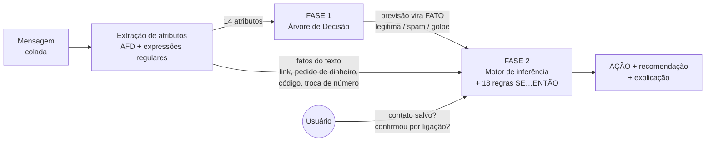
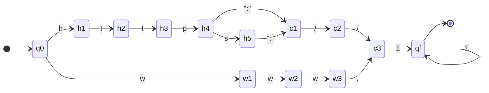

# 🛡️ Sentinela Zap

**Sistema especialista híbrido para filtrar mensagens indesejadas no WhatsApp**

[](https://colab.research.google.com/github/luis-fernando061/LFA/blob/main/Projeto_Final_Sentinela_Zap/Sentinela_Zap_Sistema_Especialista.ipynb)

| | |
|---|---|
| **Disciplina** | Linguagens Formais e Autômatos / Inteligência Artificial, UDF Centro Universitário |
| **Professora** | Kadidja Valéria |
| **Aluno** | Luis Fernando Vieira Borges (Turma N1) |
| **Tema** | Filtragem de mensagens indesejadas, no canal **WhatsApp** |
| **Entrega** | Projeto final: sistema especialista com modelo supervisionado integrado (Aulas 12 e 13) |

> A pessoa cola uma mensagem suspeita do WhatsApp e responde no máximo duas perguntas. O sistema devolve **uma ação clara** (liberar, verificar, silenciar ou bloquear e denunciar) e **explica por que** chegou a ela.

---

## ▶️ Como testar em 3 cliques

1. Clique no botão **Abrir no Colab** acima. O notebook abre direto no Google Colab, sem baixar nada.
2. No menu, clique em **Ambiente de execução → Executar tudo**.
3. Se o Colab avisar *"Este notebook não foi criado pelo Google"*, clique em **Executar mesmo assim**.

O notebook roda inteiro em cerca de 30 segundos. Não é preciso subir nenhum arquivo, porque o dataset está embutido no próprio notebook. No fim de cada teste aparece um ✅ confirmando o resultado esperado.

Link direto: https://colab.research.google.com/github/luis-fernando061/LFA/blob/main/Projeto_Final_Sentinela_Zap/Sentinela_Zap_Sistema_Especialista.ipynb

**Testado no Google Colab** (Python 3, scikit-learn 1.6.1): todas as células executaram sem erro e os 4 ✅ apareceram.

---

## 📁 O que tem nesta pasta (para que serve cada arquivo)

```
Projeto_Final_Sentinela_Zap/
├── README.md                                  ← esta página: resumo, como testar e mapa do projeto
├── Sentinela_Zap_Sistema_Especialista.ipynb   ← O PROJETO: código Python comentado, já com as saídas
├── data/
│   └── mensagens_whatsapp.csv                 ← o banco de dados: 150 mensagens rotuladas
├── GUIA_DE_ESTUDO.md                          ← guia de estudo: o sistema explicado do zero, regra por regra
├── GUIA_DE_ESTUDO.pdf                         ← o mesmo guia pronto para imprimir (17 páginas)
└── ETICA_E_IMPACTOS_IA.md                     ← análise ética e declaração de uso de IA
```

| Arquivo | Para que serve | Quando abrir |
|---|---|---|
| **`Sentinela_Zap_Sistema_Especialista.ipynb`** | É o projeto inteiro. Tem a dor, o dataset, o autômato, o treino do modelo, as 18 regras, o motor de inferência, os testes e as limitações, tudo explicado em texto entre as células de código. | Para **executar e avaliar** o sistema. O GitHub mostra o notebook com as saídas mesmo sem executar. |
| **`data/mensagens_whatsapp.csv`** | O dataset: 150 mensagens **simuladas** (50 legítimas, 50 spam, 50 golpe) com as colunas `id`, `mensagem` e `rotulo`. | Para ver os dados usados no treino e no teste. É o mesmo conteúdo embutido no notebook. |
| **`GUIA_DE_ESTUDO.md`** | A **Parte 0** explica o sistema do zero: as 3 etapas, as 14 pistas, as 2 perguntas, **cada uma das 18 regras** com exemplo e o passo a passo real de uma mensagem, ciclo por ciclo. As seções 1 a 10 ligam cada conceito das aulas ao projeto e trazem números para decorar, perguntas prováveis com resposta e um roteiro de apresentação. A seção 11 resume a ética (aula de 17/11) e a seção 12 traz a ficha de avaliação. São 32 perguntas com resposta no total. | Para **estudar** e para **explicar** o projeto. |
| **`GUIA_DE_ESTUDO.pdf`** | O mesmo guia pronto para imprimir: Parte 0 nas páginas 1 a 7, a teoria nas páginas 8 a 15 e a ética e a ficha de avaliação nas páginas 16 e 17. | Para **imprimir**. |
| **`ETICA_E_IMPACTOS_IA.md`** | **Ética e impactos da IA**, no formato do roteiro da aula de 17/11: leitura e vídeo, análise dos 5 aspectos (privacidade, viés, transparência, supervisão e impacto social) com situações reais do teste, o dilema "bloquear e denunciar × alertar", a reflexão individual e a **declaração de uso de IA** (IA incorporada ao projeto e IA usada na elaboração). | Para **ler direto no GitHub** e para responder perguntas sobre ética. |

---

## 🗺️ Mapa do notebook: o que cada seção faz

| Seção | O que mostra | Conceito da disciplina |
|---|---|---|
| **0. Capa** | Título, aluno, botão do Colab e visão geral das duas fases | – |
| **1. A dor** | Números de golpes no Brasil e a persona Dona Marta | Problema real, "dor do cliente" |
| **2. Domínio e escopo** | Público, entradas, rótulos e o que fica fora do escopo | Definição do domínio do sistema especialista |
| **3. Estudo inicial** | Respostas às perguntas do estudo inicial da Aula 13 | Estudo inicial pedido na Aula 13 |
| **4. Arquitetura** | Diagrama: texto → atributos → modelo → regras → ação | Componentes de um sistema especialista |
| **5. Bibliotecas** | `pandas`, `scikit-learn`, `matplotlib`, `re` | – |
| **6. Dataset** | Carrega as 150 mensagens e salva o CSV, explicando origem, rotulagem e o aviso de dados simulados | Dataset documentado |
| **7. LFA: AFD + regex** | **7.1** AFD M = (Q, Σ, δ, q0, F) que reconhece links. **7.2** expressões regulares dos outros sinais. **7.3** prova de que o AFD e a regex aceitam a mesma linguagem | **Linguagens Formais e Autômatos** |
| **8. Fase 1: modelo** | Treino e teste estratificados (75/25), `GridSearchCV` só no treino, acurácia, matriz de confusão, validação cruzada e desenho da árvore | **Aprendizado supervisionado** (Aula 13) |
| **9. Base de conhecimento** | As 18 regras SE…ENTÃO, com prioridade e origem | Base de conhecimento (Aula 12) |
| **10. Motor de inferência** | Encadeamento para frente, resolução de conflitos por prioridade, perguntas ao usuário e explicações "Como?" e "Por quê?" | Motor de inferência e memória de trabalho |
| **11. Integração** | A previsão do modelo vira o **fato** `previsao`, usado pelas regras R10–R18 | Integração modelo + sistema especialista |
| **12. Testes obrigatórios** | Teste positivo, teste negativo e teste com informação ausente ("não sei"), cada um com ✅ | Casos de teste (Aula 12) |
| **13. Três casos novos** | Mensagens inéditas, com análise do resultado | Teste com casos novos |
| **14. Mudando um fato** | A mesma mensagem com uma resposta diferente muda a decisão | Sensibilidade das regras |
| **15. Avaliação híbrida** | Modelo sozinho × sistema completo no conjunto de teste | **Validação** |
| **16. Verificação da base** | 432 combinações de fatos: sem regra inalcançável, sem contradição, sem ciclo | **Verificação** (Aula 12) |
| **17. Modo interativo** | Troque `MODO_INTERATIVO = False` para `True` e teste suas próprias mensagens | Uso real do sistema |
| **18. Erros e limitações** | Onde o sistema erra e por quê | Limitações |
| **19. Perguntas finais e referências** | Respostas às perguntas de análise do resultado e as fontes | Análise crítica |

---

## 1. A dor

- **2.261.055 casos de estelionato** no Brasil em 2025, alta de cerca de **430% desde 2018** (Anuário Brasileiro de Segurança Pública).
- **26,3 milhões de pessoas** sofreram golpe ou perderam dinheiro por meios digitais em 2025 (FBSP).
- Entre quem recebeu tentativas de golpe, **84% citam aplicativos de mensagem** como WhatsApp e Telegram (Cetic.br).

**Persona: Dona Marta, 63 anos.** Ela recebe de um número desconhecido:
*"Oi mãe, troquei de número. Me faz um Pix urgente que amanhã te devolvo."*
A mensagem não tem link nem erro de português, então um filtro de spam comum deixa passar. Ela precisava de alguém que dissesse: **"Número novo + diz ser parente + pede dinheiro = golpe do falso parente. Ligue para o número antigo antes de pagar."**

## 2. A solução: duas fases integradas



| Fase | Técnica | De onde vem o conhecimento |
|---|---|---|
| Extração de atributos | Um **AFD** reconhece links. **Expressões regulares** detectam pedido de dinheiro, pedido de código, troca de número, urgência e outros sinais. | Teoria de **Linguagens Formais** |
| 1. Modelo supervisionado | `DecisionTreeClassifier` (scikit-learn) | **Dados rotulados**: 150 mensagens |
| 2. Sistema especialista | Base de conhecimento, memória de trabalho e motor de inferência com encadeamento para frente | **Regras escritas** a partir de orientações de prevenção a golpes (WhatsApp, Febraban, Serasa) |

### O autômato que reconhece links

L = {`http://`, `https://`, `www.`} · Σ⁺, equivalente à expressão regular `^(https?://|www\.)\S+$`



Qualquer transição que não aparece no diagrama leva ao estado morto, que rejeita. O notebook **prova** que o AFD e a expressão regular aceitam exatamente os mesmos tokens (0 divergências).

### Exemplos de regras (são 18 no total)

| Regra | SE… | ENTÃO… |
|---|---|---|
| **R01** | trocou de número **E** pede dinheiro | padrão do golpe do falso parente |
| **R02** | pede código ou token | padrão de clonagem → **R06**: BLOQUEAR E DENUNCIAR |
| **R09** | falso parente **E** a pessoa respondeu "não sei" se confirmou por ligação | NÃO PAGAR AINDA, ligar para o número antigo |
| **R10** | modelo previu golpe **E** número desconhecido **E** há sinal de risco | BLOQUEAR E DENUNCIAR |
| **R16** | modelo previu legítima **E** contato salvo **E** pede dinheiro | VERIFICAR, porque a conta pode estar clonada |

## 3. Resultados

Os números abaixo são do conjunto de teste, que o modelo nunca viu durante o treino.

| Métrica | Resultado |
|---|---|
| Acurácia do modelo no teste (38 mensagens) | **76,3%** |
| Acurácia média na validação cruzada (5 partes) | **81,3%** (desvio padrão 4,0%) |
| Golpes com alerta: **modelo sozinho** | 7 de 12 |
| Golpes com alerta: **sistema híbrido** (modelo + regras) | **8 de 12** |
| Golpes **liberados** pelo sistema (o pior erro) | **0 de 12** |
| Mensagens legítimas **bloqueadas** (alarme falso grave) | **0 de 13** |
| Verificação da base: 432 combinações de fatos | sem regras inalcançáveis, sem contradições, sem ciclos |

**Exemplo de como as regras corrigem o modelo:** o modelo classificou *"Olá, sou do banco. Seu token expirou. Me informe o token…"* como `legitima`. A regra **R02** (pedido de código ou token → clonagem) disparou, seguida da **R06**, e o resultado foi **BLOQUEAR E DENUNCIAR**.

## 4. Entregáveis pedidos × onde estão

| Pedido nas Aulas 12 e 13 | Seção do notebook |
|---|---|
| Problema, público, entradas, rótulo e recomendação | 1 e 2 |
| Respostas do estudo inicial | 3 |
| Dataset: quantidade, origem, atributos, critério de rotulagem e aviso de dados simulados | 6 |
| Separação treino e teste, algoritmo supervisionado, acurácia e matriz de confusão | 8 |
| Pelo menos 4 regras, com origem explicada (o projeto tem 18) | 9 |
| Motor de inferência, rastro e explicação | 10 e 11 |
| Previsão integrada às regras | 11 (regras R10–R18) |
| 3 testes: positivo, negativo e informação ausente | 12 |
| 3 casos novos com análise | 13 |
| Comparação mudando um único fato | 14 |
| Verificação e validação da base | 15 e 16 |
| Erros, limitações e representatividade | 18 e 19 |
| Ética e impactos da IA e declaração de uso de IA (aula de 17/11) | Arquivo `ETICA_E_IMPACTOS_IA.md` |

## 5. Limitações

- O **dataset é simulado**: 150 mensagens escritas pela equipe. A acurácia demonstra o método, **não** a eficácia no mundo real.
- As expressões regulares têm vocabulário fixo. Golpistas variam a escrita ("p1x", "c0digo").
- O sistema não lê o WhatsApp automaticamente, porque o aplicativo não permite. Ele funciona como **consultor**: a pessoa cola a mensagem.
- Áudios, imagens e ligações estão fora do escopo.
- A recomendação **não substitui** o julgamento humano.

## Como executar fora do Colab

```bash
pip install pandas scikit-learn matplotlib jupyter
jupyter notebook Sentinela_Zap_Sistema_Especialista.ipynb
```

## Referências

- Material das Aulas 12 e 13, Profa. Kadidja Valéria (UDF).
- IBM. *Aprendizado de máquina* e *Aprendizado supervisionado*: ibm.com/br-pt/think/machine-learning
- scikit-learn: `DecisionTreeClassifier`, `GridSearchCV`, `train_test_split`, `cross_val_score`.
- Central de Ajuda do WhatsApp, Febraban e Serasa: orientações sobre golpes.
- HOPCROFT, MOTWANI, ULLMAN. *Introdução à Teoria de Autômatos, Linguagens e Computação*.
- Dados da dor: [FBSP / Brasil 61](https://brasil61.com/n/anuario-de-seguranca-publica-brasil-registrou-mais-de-2-2-milhoes-de-casos-de-estelionato-em-2025-bras2616801), [Cetic.br / Viva](https://viva.com.br/tecnologia/golpes-por-mensagem-e-ligacao-afetam-28-milhoes-de-usuarios-brasileiros.html), [Xataka](https://www.xataka.com.br/informatica/a-nova-epidemia-brasileira-nao-esta-nas-ruas-os-golpes-digitais-ja-atingem-56-milhoes-pessoas-e-crime-fisico-ficou-para).
